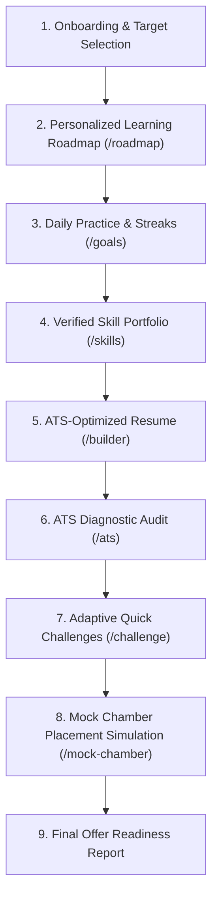

# CareerFlow — Platform Overview & Feature Architecture

> Comprehensive guide to CareerFlow: the intelligent campus placement preparation, career simulation, and AI interview platform for engineering students.

---

## 🌟 1. Platform Vision & Design Philosophy

**CareerFlow** is built specifically for computer science and engineering students preparing for top-tier software engineering (SDE), full-stack, backend, frontend, and DevOps campus placements.

Traditional placement preparation is fragmented: students draft resumes in Word, practice coding on LeetCode, track progress on notepads, and enter campus interviews without ever having spoken to a senior tech lead. **CareerFlow unifies the entire placement journey into a single reactive platform:**

```
                    ┌──────────────────────────────────────────────┐
                    │               CAREERFLOW SUITE               │
                    └──────────────────────┬───────────────────────┘
                                           │
         ┌───────────────────┬─────────────┴───────┬───────────────────┐
         ▼                   ▼                     ▼                   ▼
  1. Resume & ATS     2. Study & Roadmaps   3. Skills & Proof   4. Mock Chamber
  - AI Resume Guide   - Learning Roadmap    - Skill Tracker     - Live AI Avatars
  - Live A4 Preview   - Daily Goals         - GitHub AST Audit  - Gemini TTS Voice
  - ATS Diagnostics   - 26-Wk Heatmap       - Adaptive Test     - Diagnostic Report
```

### Visual Identity & Theme
CareerFlow uses an authentic **manga-sketch paper editorial aesthetic**:
- Warm paper canvas (`#faf8f5`) with ink-black high-contrast text (`#141416`).
- Organic hand-drawn borders (`sketch-border`, `sketch-border-sm`).
- Vibrant crimson accent (`#e11d48`) representing ambition, momentum, and focus.
- Lightweight, snappy, and zero-distraction layout optimized for desktop and mobile.

---

## 🚀 2. Core Modules & Feature Breakdown

### 📄 Feature 1: AI-Guided Reactive Resume Builder (`/builder`)
**Author / Main Contributor:** Raj / Team

The Resume Builder transforms traditional static resume forms into an **interactive, conversational AI coaching flow** while rendering a live, pixel-perfect A4 ATS preview.

- **Interactive Section Stepper:**
  - Guides students through: `Basics ➔ Experience ➔ Education ➔ Skills ➔ Projects ➔ Honors ➔ Theme`.
  - Shows visual status indicators for completed, current, and pending sections.
- **One-Question-at-a-Time Guidance:**
  - The AI Career Coach asks focused questions for each section rather than overwhelming the student with a massive form.
- **Hinglish & Shorthand Understanding:**
  - Candidates can reply in casual language or rough notes (e.g. *"stripe me intern tha, redis caching kiya latency kam karne ke liye"*).
  - The AI elevates the input into professional, high-impact bullet points with strong action verbs (*Engineered, Architected, Optimized*).
- **Strict Honesty Guardrails (Critical):**
  - **Zero Metric Fabrication:** The AI NEVER invents numbers, percentages, dates, degrees, or company names the user didn't mention.
  - Suggests quantifiable impact or asks follow-up questions only when beneficial.
- **Live Reactive A4 Preview:**
  - Updates in real-time as the AI outputs JSON patches.
  - Highlights recently updated sections with a subtle red/rose glow and smoothly scrolls to them.
  - Displays faint placeholder skeletons for empty sections (e.g. *"Click to add experience with AI +"*).
  - Clicking any section in the preview jumps the AI guide to that section.
- **Voice Mic Input:**
  - Integrated speech-to-text via Web Speech API (`SpeechRecognition`) for hands-free verbal answering.
- **Smart Workflows:**
  - **Import Existing Resume (PDF/DOCX/TXT):** Parses uploaded documents directly into structured JSON and identifies missing sections.
  - **Target Job Description Mode:** Pastes a job description to naturally align genuine keywords with ATS requirements.
  - **Undo / Redo Stack:** Built-in 30-step state history.
  - **Manual Form Mode Toggle:** Instant switch to classic manual inputs for full granular control.
  - **Export PDF & JSON:** Print-optimized A4 CSS styling with zero blank-page clipping.

---

### 🎯 Feature 2: ATS Diagnostic Scanner & Redlining (`/ats`)
**Author / Main Contributor:** Main / Kush

A comprehensive applicant tracking system diagnostic tool that evaluates resumes against tech industry hiring standards.

- **Multi-Dimensional Scoring:**
  - **Overall ATS Score (0 - 100%)** with placement readiness rating (*Exceptional*, *Competitive*, *Needs Improvement*, *Critical Issues*).
  - **Keyword Match Rate:** Evaluates technical keywords against modern industry stacks.
  - **Quantifiable Impact:** Checks for STAR metrics (percentages, numbers, latency, scale).
  - **Structure & Format:** Audits single-page length, contact info, and section headers.
  - **Readability & Length:** Estimates reading time and word count.
- **Bullet-by-Bullet Redlining:**
  - Scans every bullet point, detects weak or passive phrasing (*"worked on"*, *"assisted with"*), and generates active STAR replacements with rationale.
- **Job Description Targeting:**
  - Paste any job posting to calculate matched vs. missing keywords.
- **File Upload Support:**
  - Supports `.pdf`, `.docx`, and `.txt` with text extraction.

---

### 🎙️ Feature 3: Mock Chamber — AI Placement Interview Simulator (`/mock-chamber`)
**Author / Main Contributor:** Main / Team

An immersive, real-time technical and behavioral interview simulation environment powered by Google Gemini AI and realistic voice synthesis.

- **Interviewer Personas:**
  - **Priya (Female Interviewer):** *Principal Systems Architect & Tech Lead.* Warm, conversational, highly focused on system design and problem-solving.
  - **Rahul (Male Interviewer):** *Director of Engineering & Pragmatic Bar-Raiser.* Relaxed, confident, focused on practical STAR impact and engineering decisions.
- **Video Sync & Voice Audio:**
  - High-fidelity Gemini TTS audio generation (`gemini-3.8-flash-tts` / `gemini-3.1-flash-tts-preview`).
  - Synced video avatars that animate while speaking and remain in an attentive idle state while the candidate responds.
- **Dynamic 5-Round Interview Plan:**
  - Tailored to role (*Full-Stack, Backend, Frontend, DevOps, AI/ML, Data Science*) and experience level (*Fresher, 1-2 years, 3+ years*).
  - Modes: **Technical**, **HR / Behavioral**, or **Mixed**.
  - **Resume-Driven Option:** Uploads candidate resume so the interviewer asks specific questions about the candidate's real projects and technologies.
- **Turn-by-Turn Adaptive Flow:**
  - Dynamically evaluates candidate responses and adjusts the difficulty and topic of subsequent questions.
- **Real-Time Voice & Text Capture:**
  - Supports microphone voice speech recognition or manual keyboard entry.
- **Comprehensive Diagnostic Placement Report (`/mock-chamber/report/:id`):**
  - **3-Pillar Evaluation:** Confidence & Tone, Communication & Clarity, Technical Correctness.
  - Senior interviewer feedback summary.
  - Key demonstrated strengths and high-impact growth recommendations.
  - Question-by-question deep dive with scores and suggested answer redlines.
  - One-click print/PDF report download.

---

### 📅 Feature 4: Daily Goals & Streak Heatmap (`/goals`, `/dashboard`)
**Author / Main Contributor:** Piyush

A placement habit engine that ensures candidates maintain daily consistency in problem-solving and interview preparation.

- **Daily Target Setting:**
  - Pre-configured categories: DSA practice, System Design revision, Mock tests, Core CS fundamentals, and custom targets.
  - Set target values, units (e.g. *problems*, *hours*, *modules*), and color tags.
- **26-Week (182-Day) Activity Heatmap:**
  - GitHub-style contribution grid visualising daily goal completion intensity.
- **Streak & Consistency Metrics:**
  - Tracks **Current Streak**, **All-Time Best Streak**, and daily completion rates.
  - Weekly summary breakdown (*planned vs. completed vs. missed*).
- **Per-Goal Granular Analytics:**
  - Click on any goal to view its dedicated 30-day consistency rate, total check-offs, and streak history.
- **Guest & Authenticated Persistence:**
  - Works seamlessly with Google OAuth or guest mode with local/server synchronization.

---

### 🗺️ Feature 5: Personalized AI Learning Roadmap (`/roadmap`)
**Author / Main Contributor:** Ritesh

An AI-generated academic blueprint and multi-week curriculum tailored to the candidate's exact career target.

- **Intelligent Curriculum Generation:**
  - Configured through a fast wizard: Career Goal (*e.g. DevOps Engineer, Full-Stack Developer*), Academic Year (*1st, 2nd, 3rd, Final Year*), Experience Level (*Beginner, Intermediate, Advanced*), and Weekly Hours.
  - Gemini AI generates a comprehensive multi-week syllabus with milestones and estimated time.
- **Interactive Weekly Syllabus:**
  - Expandable weeks with modular topics and subtopics.
  - Status management: *Pending*, *In Progress*, *Completed*.
  - Confidence Slider (0 - 100%) to self-evaluate topic mastery.
  - Topic-level markdown personal study notes.
- **Automated Streak Integration:**
  - Completing a roadmap topic automatically syncs and increments the user's daily study streak!
- **AI Recommendation Engine:**
  - Generates real-time curated study materials: official documentation, video courses, practice problems, and interview questions.
  - One-click "Refresh Recommendations" button to adapt as the student marks topics complete.
- **Archive & Reset Support:**
  - Easily archive current roadmap to start a new career goal anytime.

---

### 🛡️ Feature 6: Skill Tracker with GitHub Proof Verification (`/skills`)
**Author / Main Contributor:** Kush

A verifiable technical skill matrix that prevents resume inflation by linking skills to audited GitHub repositories.

- **Multi-Category Skill Matrix:**
  - Covers **Frontend**, **Backend**, **Programming**, **Core CS & DSA**, **Database**, and **DevOps & Cloud**.
  - Tracks proficiency level (*Beginner, Intermediate, Advanced*) and progress percentage.
- **GitHub AST Code Audit & Verification Engine:**
  - Paste any GitHub repository URL as proof of skill.
  - The backend connects via GitHub API, extracts repository files and structural AST, and submits them to Gemini AI.
  - AI verifies whether the codebase demonstrates genuine architectural depth (hooks, generic typing, transactions, concurrency, error handling).
  - Assigns an official **Verified Badge (✓)** with AI review summary and key audited strengths.
- **Skill Statistics:**
  - Visual metrics showing total skills, verified count, verification rate percentage, and category breakdown.

---

### ⚡ Feature 7: Adaptive AI Quick Challenges (`/challenge/setup`, `/challenge/:id`)
**Author / Main Contributor:** Kush

Rapid technical micro-challenges that simulate fast-paced placement coding rounds and technical screenings.

- **Configurable Challenge Setup:**
  - Select career goal, number of questions (3 to 25), and difficulty (*Beginner, Intermediate, Advanced, Adaptive*).
  - Optional resume upload to test candidate claims on their actual projects.
- **Adaptive Difficulty Engine:**
  - When set to **Adaptive**, the AI continuously gauges response depth:
    - Strong answers bump the difficulty to Advanced architectural questions.
    - Shaky answers pivot to foundational troubleshooting.
- **Live Challenge Room:**
  - Clean question view with keyword hints, code block support, and immediate AI feedback.
- **Detailed Scorecard & Results (`/challenge/:id/results`):**
  - Overall performance score, strengths identified, growth areas, and turn-by-turn question reviews.

---

## 🛠️ 3. Architecture & Tech Stack

### Frontend Architecture
- **Framework:** React 19 with Vite 8.
- **Routing:** React Router v7 (`createBrowserRouter`) with global `RouteErrorBoundary`.
- **Styling:** Tailwind CSS v4, custom manga-sketch borders (`sketch-border`), and Caveat handwriting accents.
- **Icons:** Lucide React (`lucide-react`).
- **State & Data Fetching:** React Hooks, Redux Toolkit, TanStack Query, Axios.
- **Voice / Speech:** Web Speech API (`SpeechRecognition` & `SpeechSynthesis`).

### Backend Architecture
- **Runtime:** Node.js with TypeScript (`tsx` in dev, `tsc` for production build).
- **Web Framework:** Express v5 with Helmet security headers, CORS, and Cookie-Parser.
- **Database:** MongoDB via Mongoose v9, with robust in-memory fallbacks when MongoDB is disconnected.
- **Authentication:** Google OAuth, JSON Web Tokens (JWT) stored in httpOnly cookies, with dual `isAuth` (strict) and `optionalAuth` (guest support) middlewares.
- **File Ingestion:** Multer (memory/disk), Mammoth (DOCX extraction), and `pdf-parse` (PDF extraction).

### AI & Speech Engine
- **SDK:** Official `@google/genai` (v3.6.0) with `{ apiVersion: 'v1beta' }`.
- **Text & Evaluation Models:**
  - Primary: `process.env.GEMINI_TEXT_MODEL` (default: `gemini-3.5-flash-lite`).
  - Fallback: `gemini-3.1-flash-lite`, `gemini-2.5-flash`.
- **Speech Synthesis (TTS) Models:**
  - Primary: `process.env.GEMINI_TTS_MODEL` (default: `gemini-3.8-flash-tts`).
  - Personas: Kore (Female voice: Priya) and Puck (Male voice: Rahul).

---

## 🗺️ 4. Application Routes Reference

### Frontend Pages (`client/src/app/app.routes.tsx`)
| URL Path | Component | Purpose |
|---|---|---|
| `/` | `Home.tsx` | Platform Landing & Feature Hub |
| `/builder` | `ResumeBuilder.tsx` | AI-Guided Resume Builder & Live Preview |
| `/ats` | `AtsChecker.tsx` | ATS Scanner & Redline Diagnostic Engine |
| `/goals`, `/dashboard` | `DailyGoals.tsx` | Daily Goal Setting, Streaks & 26-Wk Heatmap |
| `/mock-chamber` | `MockChamberLanding.tsx`| AI Placement Interview Setup |
| `/mock-chamber/room` | `MockChamberRoom.tsx` | Live Voice/Video Interview Session |
| `/mock-chamber/report/:id`| `MockChamberReport.tsx`| Diagnostic Placement Interview Report |
| `/roadmap` | `RoadmapPage.tsx` | Personalized AI Learning Roadmap & Blueprint |
| `/skills` | `SkillTracker.tsx` | Skill Matrix & GitHub Code Verification |
| `/challenge/setup` | `QuickChallengeSetup.tsx`| Micro-Challenge Configuration |
| `/challenge/:id` | `LiveChallenge.tsx` | Adaptive Live Micro-Challenge |
| `/challenge/:id/results` | `ChallengeResults.tsx` | Challenge Final Evaluation Scorecard |

### Backend API Prefixes (`server/src/app.ts`)
| API Base Path | Router File | Primary Domain |
|---|---|---|
| `/api/auth` | `server/src/routes/authRoute.ts` | Authentication & User Me Profile |
| `/api/resumes` | `server/src/routes/resumeRoute.ts` | Resume CRUD & Sample Templates |
| `/api/resume-ai` | `server/src/routes/resumeAi.routes.ts` | AI Resume Guide Chat & Document Parser |
| `/api/ats` | `server/src/routes/atsRoute.ts` | ATS Text & Document Analysis |
| `/api/goals` | `server/src/routes/goalRoute.ts` | Daily Goals, Progress & Streak Stats |
| `/api/mock-interview` | `server/src/routes/interview.routes.ts`| Mock Chamber Engine, TTS & STT |
| `/api/roadmap` | `server/src/routes/roadmapRoute.ts` | Multi-Week AI Roadmaps & Recommendations |
| `/api/skills` | `server/src/routes/skillRoute.ts` | Skills CRUD & GitHub AST Verification |
| `/api/challenges` | `server/src/routes/challengeRoute.ts` | Adaptive Interview Challenges Engine |

---

## 🎓 5. End-to-End Student Preparation Journey



1. **Step 1 — Curriculum Generation:** The student selects their dream role on `/roadmap`. The AI generates a customized weekly study plan.
2. **Step 2 — Daily Consistency:** The student tracks daily DSA and core revisions on `/goals`, building a 26-week streak heatmap.
3. **Step 3 — Skill Proof:** Projects are verified by linking GitHub repositories on `/skills`, earning audited AI badges.
4. **Step 4 — Resume Crafting:** Using the AI Guide on `/builder`, the student turns rough notes into high-impact, ATS-friendly bullets with live preview.
5. **Step 5 — Pre-Screening Audit:** The student scans their resume against real job descriptions on `/ats` to eliminate red flags.
6. **Step 6 — Pressure Testing:** Quick adaptive challenges on `/challenge` test problem-solving agility.
7. **Step 7 — Placement Interview:** In the `/mock-chamber`, Priya or Rahul conducts a voice interview with Gemini TTS and video avatars.
8. **Step 8 — Diagnostic Feedback:** The student receives an evaluation report detailing strengths, communication pillars, and growth recommendations.
